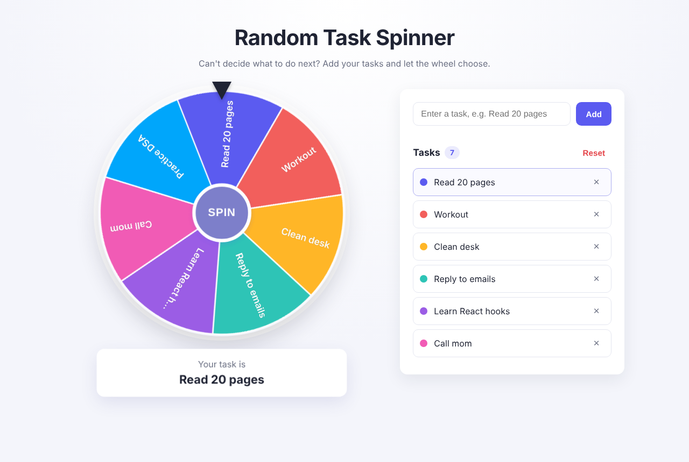
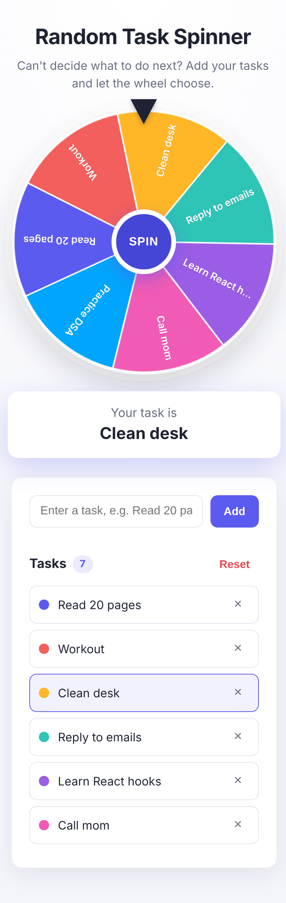

# Random Task Spinner

Can't decide what to work on next? Add your tasks, spin the wheel, and let it pick one for you.

A small, dependency-free web app built with plain HTML, CSS and JavaScript.



## Features

- **Add tasks** with the Add button or by pressing Enter. Empty tasks are rejected.
- **Remove** any task, or **Reset** to clear the whole list.
- **Colorful wheel** split into equal slices, one per task, with the task name on each slice.
- **Smooth spin** with an ease-out animation that slows down like a real wheel.
- **Accurate pointer**: the result is read from the wheel's final angle, so the announced task is always the slice under the pointer.
- **Spin button disabled** while the wheel is turning.
- Task count, a friendly empty state, and the winning task highlighted in the list.
- Tasks are saved in your browser (localStorage), so they're still there after a refresh.
- Responsive layout for desktop and mobile.



## Tech stack

- **HTML** for structure (`index.html`)
- **CSS** for layout, styling and the spin transition (`style.css`)
- **Vanilla JavaScript** + Canvas for drawing the wheel and app logic (`script.js`)

No frameworks, no libraries, no build step.

## How it works

The wheel is drawn on a `<canvas>`, with slice 0 starting at the top and going clockwise. When you spin, the app picks a random task, works out the rotation that brings a random point inside that slice under the pointer, adds 5 to 7 full turns, and applies it with a CSS `transform` transition. When the animation ends, it reads the slice at the pointer from the final rotation and shows it.

## Run locally

```bash
git clone https://github.com/udit065/random-task-spinner.git
cd random-task-spinner
```

Then open `index.html` in your browser. That's it.
